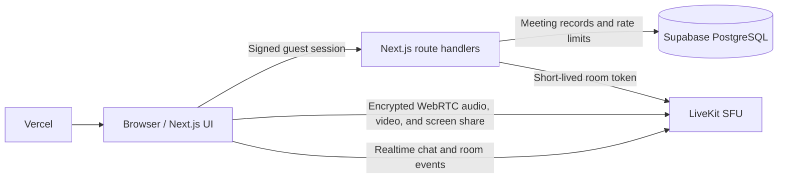

# VibeMeet

**Meet. Connect. Collaborate.**

VibeMeet is a responsive, guest-friendly video meeting app built with Next.js App Router, TypeScript, Tailwind CSS, LiveKit, and Supabase. It is structured for deployment to Vercel.

## Features

- Branded, responsive landing page with create/join flows
- `RAJ-XXX-XXX` room codes and scheduled meetings
- Camera/microphone preview, device selection, and guest display names
- LiveKit SFU video, screen sharing, chat, reactions, and participant controls
- Signed, HTTP-only guest sessions; host-only locking, mute-all, removal, host transfer, and end-for-all controls
- Server-side LiveKit token generation; API keys and database service credentials never go to the browser
- Supabase persistence for meetings, participants, messages, and recording metadata
- Persistent, database-backed rate limits for session, meeting-creation, token, and host-control endpoints
- Dashboard, meeting history, invite links, and recordings list
- Dark color-scheme support, keyboard-accessible controls, and mobile layouts

## Architecture



The browser joins LiveKit directly after the server validates the room and creates a short-lived participant token. Supabase service-role access is restricted to server route handlers. Room chat uses LiveKit's realtime data channel; the `messages` table is included for a future durable-chat integration.

## Requirements

- Node.js 20.9 or newer
- npm
- A Supabase project
- A LiveKit Cloud project (or a self-hosted LiveKit server reachable by your clients)

## Local setup

1. Install packages:

   ```bash
   npm install
   ```

2. Copy `.env.example` to `.env.local` and fill in the values below. Create a random `SESSION_SECRET` (at least 32 random bytes); keep all secrets server-side. In local development, the app falls back to a non-production dev secret if `SESSION_SECRET` is omitted so the UI can boot and you can test flows before wiring env vars.

3. In the Supabase SQL Editor, run [`supabase/migrations/20261107000000_initial_schema.sql`](./supabase/migrations/20261107000000_initial_schema.sql). It creates the tables, indexes, RLS restrictions, and atomic rate-limit function used by the app.

4. In LiveKit Cloud, create a project and copy its WebSocket URL and API credentials. Allow your deployed site's origin in the project's allowed origins/CORS settings. Do not put the API secret in a `NEXT_PUBLIC_` variable.

5. Start the app:

   ```bash
   npm run dev
   ```

6. Open [http://localhost:3000](http://localhost:3000), create a meeting, enter a display name in the lobby, and allow camera/microphone permissions.

## Environment variables

| Variable                    | Required                                   | Purpose                                                                                                  |
| --------------------------- | ------------------------------------------ | -------------------------------------------------------------------------------------------------------- |
| `NEXT_PUBLIC_SUPABASE_URL`  | Yes                                        | Supabase project URL                                                                                     |
| `SUPABASE_SERVICE_ROLE_KEY` | Yes                                        | Server-only database access; never expose to a client                                                    |
| `SESSION_SECRET`            | Local dev fallback; required in production | Signs guest-session cookies and pseudonymizes rate-limit keys                                            |
| `LIVEKIT_URL`               | Yes                                        | LiveKit WebSocket URL used by browsers, typically `wss://...`                                            |
| `LIVEKIT_API_KEY`           | Yes                                        | Server-only LiveKit API key                                                                              |
| `LIVEKIT_API_SECRET`        | Yes                                        | Server-only LiveKit API secret                                                                           |
| `LIVEKIT_API_URL`           | Optional                                   | HTTPS LiveKit server URL for administrative room controls; defaults to converting `LIVEKIT_URL` to HTTPS |

## Authentication and user identity

VibeMeet supports both **registered accounts** and **seamless guest joins**:

- **Email & Password Authentication**: Users can log in or create an account (`/login` and `/signup`) powered by Supabase Auth and synced with `public.users`.
- **Signed Sessions**: Cryptographically signed (`HMAC-SHA256`), 7-day HTTP-only cookies (`vibemeet_session`). Session cookies are `HttpOnly`, `SameSite=Lax`, and secure in production.
- **Cross-device Persistence**: Logged-in users have their scheduled meetings, meeting history, and recordings synced across devices and sessions.
- **Guest Access**: Instant meetings and room joining continue to work without requiring an account (`vibemeet_guest`), with easy prompts to sign in or create an account when desired.

## Recording

The recordings page and database schema are ready to display recording metadata. Starting/stopping LiveKit Egress and provisioning recording object storage are not enabled in this starter. Configure LiveKit Egress and a private S3-compatible bucket before adding recording controls; do not make a public recording URL the default.

## Deployment to Vercel

1. Push the project to a Git provider and import it in Vercel (Framework Preset: Next.js).
2. Add every required environment variable above in **Project Settings → Environment Variables** for Preview and Production. Use separate Supabase/LiveKit credentials for non-production deployments when possible.
3. Run the Supabase migration against the production project before the first deployment.
4. Deploy. Vercel detects the Next.js build automatically; the application uses Node.js route handlers for cryptographic sessions, Supabase access, and LiveKit controls.
5. Add the final Vercel domain to LiveKit's allowed origins, then test create, scheduled invite, join from a second browser, lock, mute-all, and end-for-all.

## Scripts

```bash
npm run dev       # Local development
npm run lint      # ESLint
npm run typecheck # TypeScript
npm run build     # Production build
```

## Screenshots

Add current screenshots of the landing page, lobby, and in-meeting view here after configuring LiveKit and running the app.
